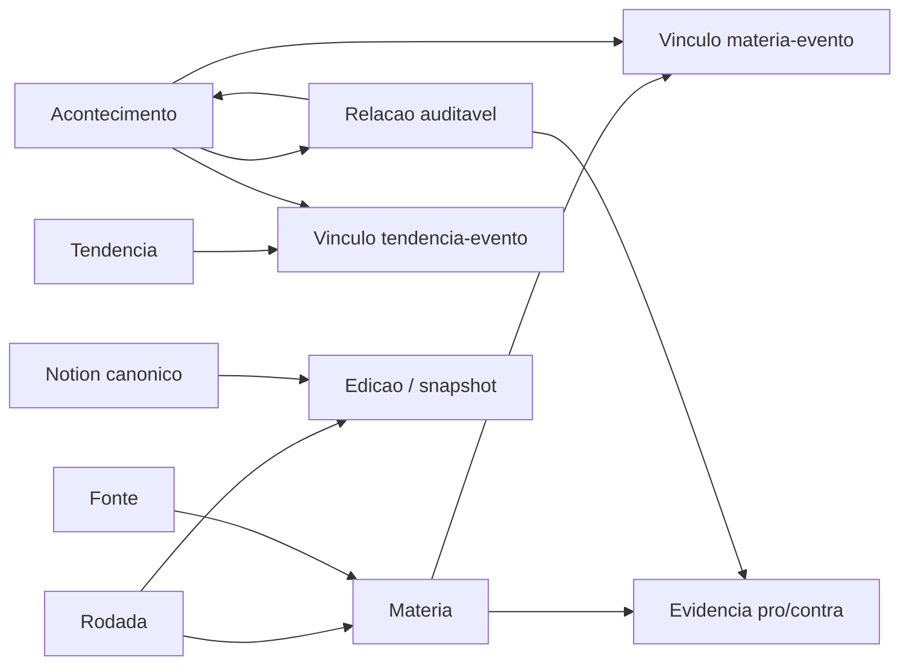

# Camini Observatorio - Marco A

Registro tecnico da fundacao e do primeiro fluxo vertical, auditado em
20/10/2026. Este marco nao cria telas, nao publica conteudo e nao altera o
Radar Tributario.

## Fontes de verdade

- Notion e o CMS editorial canonico para texto, revisao e aprovacao.
- Supabase e a memoria operacional de fontes, materias, acontecimentos,
  relacoes, evidencias, tendencias, rodadas e snapshots.
- O Camini so podera projetar publicamente edicoes com estado `publicada`,
  aprovacao e data de publicacao.

Documentos consultados integralmente:

- [Projeto e arquitetura](https://app.notion.com/p/3ff13c241b4d818e8fb3f46dce937cca)
- [Handoff tecnico v1.0](https://app.notion.com/p/3ff13c241b4d81c987cfcab0b34dff2c)
- [Kickoff do Marco A](https://app.notion.com/p/3ff13c241b4d81f69d2ecdc862875d68)

## Diagnostico inicial

O remoto ja continha a migration
`20261020123117_observatorio_camini_grafo_v1`, dez tabelas com RLS ativo e a
coleta inaugural. O repositorio local nao continha a migration, tipos gerados,
contratos do dominio nem testes do pipeline.

Contagens remotas lidas sem mutacao:

| Entidade | Registros |
| --- | ---: |
| Rodadas | 2 |
| Fontes | 5 |
| Materias | 11 |
| Acontecimentos | 11 |
| Vinculos materia-evento | 14 |
| Relacoes | 3 |
| Evidencias de relacao | 5 |
| Tendencias | 2 |
| Vinculos tendencia-evento | 6 |
| Edicoes | 2 candidatas, 0 publicadas |

O remoto nao possui policies nem grants para `anon` ou `authenticated` nas
tabelas do Observatorio. Somente `service_role` possui privilegios. Isso e
intencional neste marco: RLS sem policy nega o corpus a clientes comuns.

O advisor de seguranca informa `rls_enabled_no_policy` para as dez tabelas. O
achado e informativo e corresponde ao modelo privado atual, nao a uma liberacao
acidental. Permanecem fora do escopo os alertas preexistentes de
`public.public_routes` sem RLS e das funcoes `public.has_route_access` e
`public.is_super_admin` executaveis como `SECURITY DEFINER`. Remediacoes oficiais:
[RLS sem policy](https://supabase.com/docs/guides/database/database-linter?lint=0008_rls_enabled_no_policy),
[RLS desabilitado](https://supabase.com/docs/guides/database/database-linter?lint=0013_rls_disabled_in_public)
e [funcao SECURITY DEFINER publica](https://supabase.com/docs/guides/database/database-linter?lint=0028_anon_security_definer_function_executable).

Existe drift historico anterior no modulo Radar: as quatro migrations remotas
anteriores tem versoes/nomes diferentes dos quatro arquivos locais de 06/10.
Esse drift foi apenas registrado, pois corrigi-lo foge do escopo e poderia
afetar o Radar.

## Mapa de dados

Identidades e restricoes principais:

- rodada: `run_key` unico;
- fonte: dominio canonico unico;
- materia: URL canonica unica;
- acontecimento: chave semantica deterministica unica;
- materia-evento: PK composta `(evento_id, materia_id)`;
- relacao: unica por `(origem_id, destino_id, tipo)`, sem auto-relacao;
- evidencia: PK composta `(relacao_id, materia_id, papel)`;
- tendencia: `slug` unico;
- edicao: `identificador` e `notion_page_id` unicos; uma edicao publicada
  exige `aprovada_em` e `publicada_em`.

## Reconciliacao do banco

O arquivo
`supabase/migrations/20261020123117_observatorio_camini_grafo_v1.sql` usa a
mesma versao e o mesmo nome registrados remotamente. Ele representa colunas,
defaults, checks, FKs, indices, comentarios, RLS e grants observados no catalogo
do Postgres.

O arquivo e um baseline para ambientes limpos. Nao foi aplicado no projeto
remoto, pois a versao ja consta no historico e as tabelas contem dados reais.
Nao houve `DROP`, `TRUNCATE`, alteracao de ID ou escrita nos registros
inaugurais.

O advisor de performance registrou seis FKs sem indice de cobertura
(`edicoes.rodada_id`, `eventos.evento_canonico_id`,
`eventos_materias.materia_id`, `materias.fonte_id`,
`relacoes_evidencias.materia_id` e `tendencias_eventos.evento_id`). Elas nao
foram adicionadas ao baseline porque isso deixaria de representar o schema vivo.
Devem entrar em migration incremental propria, depois de revisar planos e
padroes de consulta. Referencia: [unindexed foreign keys](https://supabase.com/docs/guides/database/database-linter?lint=0001_unindexed_foreign_keys).

Depois de qualquer mudanca futura de schema, regenerar
`lib/supabase/database.types.ts` pelo Supabase CLI ou pela integracao oficial.

## Camada de dominio

`lib/observatorio` esta dividida em:

- `types.ts`: contratos alinhados ao schema e vocabulario editorial;
- `normalization.ts`: URL canonica, dominio e timestamp com fuso explicito;
- `identity.ts`: `run_key`, chave de evento, fingerprint e IDs deterministas
  para o ambiente isolado;
- `validation.ts`: validacao runtime sem dependencia nova;
- `repository.ts`: contrato transacional e implementacao isolada em memoria;
- `ingestion.ts`: orquestracao idempotente de rodada, fonte, materia, evento,
  vinculo, relacao e evidencia;
- `publication.ts`: regra minima que exclui candidatas da projecao publica;
- `supabase-read-repository.ts`: leitura privada, tipada e exclusivamente no
  servidor;
- `server.ts`: entrypoint server-only que exige `getUser()` e permissao de
  `/dashboard/observatorio`; o barrel geral nao exporta credenciais.

A entrada diferencia noticia, paper, documento e analise. Para papers, registra
preprint, revisao por pares ou estado desconhecido no contrato existente
`revisao_por_pares`. Datas de publicacao, coleta, acontecimento e rodada sao
independentes e timestamps sem `Z`/offset sao rejeitados.

Relacoes causais nunca sao inferidas. Uma entrada explicitamente marcada como
`causal_comprovada` so e aceita com evidencia `confirmado` e uma base causal
textual. Toda relacao exige ao menos uma materia rastreavel, inclusive para
evidencia que contradiz ou apenas contextualiza.

## Seguranca e falhas parciais

- A credencial privilegiada usa `SUPABASE_SECRET_KEY` ou, durante a transicao,
  `SUPABASE_SERVICE_ROLE_KEY`; nenhuma recebe prefixo `NEXT_PUBLIC_`.
- O cliente administrativo usa `@supabase/supabase-js` separado do cliente SSR,
  sem cookies, persistencia de sessao, refresh automatico ou leitura de URL.
- O entrypoint consumivel por paginas primeiro valida o usuario com `getUser()`
  e consulta a propria permissao por RLS antes de usar a leitura privilegiada.
- Consultas selecionam colunas explicitamente e tem limite maximo de 1.000
  registros por tabela.
- Erros do PostgREST ficam na causa server-side; a mensagem publica e generica.
- Nao existe escrita remota neste marco. Isso impede que uma sequencia de
  upserts sem transacao deixe estado parcial no banco vivo.
- A implementacao em memoria fornece transacao com rollback e prova o fluxo
  completo em ambiente isolado. O proximo adapter de escrita deve usar uma RPC
  transacional revisada, com permissoes restritas, ou estrategia equivalente.

## Verificacao

Linha de base antes das mudancas:

- `npx tsc --noEmit`: sucesso;
- `npm run build`: sucesso, 61 paginas geradas;
- `npm run lint`: falha preexistente, 21 erros e 24 avisos fora do Observatorio.

Verificacao focada apos a implementacao:

- `npm run test:observatorio`: 6 testes, 6 aprovados;
- `npx tsc --noEmit`: sucesso;
- `npx eslint lib/observatorio lib/supabase/database.types.ts`: sucesso.
- `npm run build`: sucesso, 61 paginas geradas e rotas do Radar preservadas;
- `npm run lint`: continua com os mesmos 21 erros e 24 avisos preexistentes,
  sem ocorrencia em `lib/observatorio` ou nos tipos gerados.
- leitura REST de `observatorio_edicoes` com a chave anonima local: bloqueada
  com HTTP 401; nenhuma candidata foi retornada.

`supabase migration list --local` foi tentado, mas a instancia local nao estava
ativa (`ECONNREFUSED 127.0.0.1:54322`) e o Docker Desktop estava desligado. O
historico remoto foi verificado pela integracao do Supabase: a versao
`20261020123117` esta aplicada. O teste estrutural local valida as dez tabelas,
RLS e ausencia de DDL destrutivo no baseline; uma aplicacao completa em Postgres
limpo continua pendente de ambiente local ativo.

Os testes cobrem estrutura e carater nao destrutivo do baseline, canonicalizacao,
fuso, primeira ingestao, segunda ingestao sem duplicacao, rollback de falha
parcial, bloqueio de causalidade sem fundamento e invisibilidade de edicao
candidata.

## Limites e proximo marco

A leitura remota do codigo requer que uma Secret Key seja configurada no
ambiente do servidor. A integracao de auditoria confirmou o acesso e o estado
real, mas o clone local nao contem essa credencial, portanto o adapter nao foi
executado localmente contra producao.

O Marco B deve adicionar adaptadores de coleta permitidos, fila/retry,
telemetria por rodada e uma unica operacao transacional de escrita. Depois,
deve sincronizar Notion para Supabase apenas quando a transicao editorial for
explicitamente aprovada, preservando versoes, contraditorios e correcoes.
